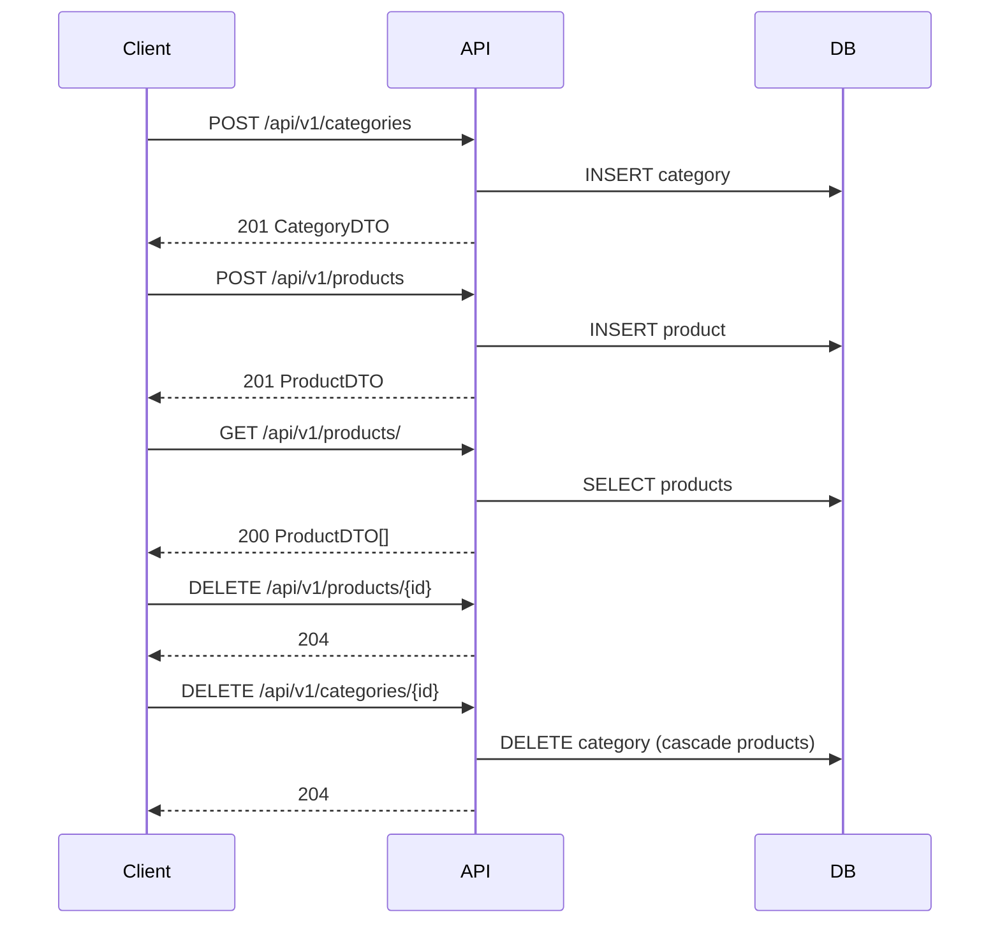

# API-Referenz

## Übersicht

| Eigenschaft | Wert |
|-------------|------|
| Basis-URL | `http://localhost:8080` |
| API-Präfix | `/api/v1` |
| Format | JSON (`Content-Type: application/json`) |
| Authentifizierung | Keine |
| Zeichensatz | UTF-8 |

Alle Zeitstempel (`createdAt`, `updatedAt`) werden als ISO-8601 ohne Zeitzone serialisiert (`LocalDateTime`), z. B. `2026-05-25T11:04:09.039`.

---

## Ressourcen

| Ressource | Pfad | Beschreibung |
|-----------|------|--------------|
| Kategorien | `/api/v1/categories` | Gruppierung von Produkten |
| Produkte | `/api/v1/products` | Einzelne Gefrierware |

**Beziehung:** Jedes Produkt gehört zu genau einer Kategorie (`categoryId`). Beim Löschen einer Kategorie werden zugehörige Produkte per Cascade mitgelöscht.

---

## Datenmodelle

### CategoryRequest

Request-Body für `POST` und `PUT` auf Kategorien.

| Feld | Typ | Pflicht | Beschreibung |
|------|-----|---------|--------------|
| `name` | string | ja | Anzeigename (nicht leer) |

```json
{
  "name": "Desserts"
}
```

### CategoryDTO

Antwort bei Kategorie-Operationen.

| Feld | Typ | Beschreibung |
|------|-----|--------------|
| `id` | number | Primärschlüssel |
| `name` | string | Anzeigename |
| `createdAt` | string (datetime) | Erstellungszeitpunkt |
| `updatedAt` | string (datetime) | Letzte Änderung |

```json
{
  "id": 1,
  "name": "Desserts",
  "createdAt": "2026-05-25T06:28:21.056406",
  "updatedAt": "2026-05-25T06:28:21.056406"
}
```

### ProductRequest

Request-Body für `POST` und `PUT` auf Produkte.

| Feld | Typ | Pflicht | Beschreibung |
|------|-----|---------|--------------|
| `name` | string | ja | Produktname (nicht leer) |
| `description` | string | nein | Optionale Beschreibung |
| `categoryId` | number | ja | ID einer existierenden Kategorie |

```json
{
  "name": "Ice cream",
  "description": "Vanilla",
  "categoryId": 1
}
```

### ProductDTO

Antwort bei Produkt-Operationen.

| Feld | Typ | Beschreibung |
|------|-----|--------------|
| `id` | number | Primärschlüssel |
| `name` | string | Produktname |
| `description` | string | Beschreibung (kann `null` sein) |
| `categoryName` | string | Name der Kategorie (kann `null` sein) |
| `createdAt` | string (datetime) | Erstellungszeitpunkt |
| `updatedAt` | string (datetime) | Letzte Änderung |

```json
{
  "id": 1,
  "name": "Ice cream",
  "description": "Vanilla",
  "categoryName": "Desserts",
  "createdAt": "2026-05-25T06:28:21.150304",
  "updatedAt": "2026-05-25T06:28:21.150304"
}
```

---

## Kategorien

Basis-Pfad: `/api/v1/categories`

### Alle Kategorien abrufen

```http
GET /api/v1/categories
GET /api/v1/categories/
```

| | |
|--|--|
| **Erfolg** | `200 OK` |
| **Body** | Array von `CategoryDTO` |

```bash
curl http://localhost:8080/api/v1/categories/
```

---

### Kategorie nach ID abrufen

```http
GET /api/v1/categories/{id}
```

| Parameter | Ort | Typ | Beschreibung |
|-----------|-----|-----|--------------|
| `id` | Pfad | number | Kategorie-ID |

| Status | Bedingung |
|--------|-----------|
| `200 OK` | Kategorie gefunden |
| `404 Not Found` | Kategorie existiert nicht |

---

### Kategorie anlegen

```http
POST /api/v1/categories
Content-Type: application/json
```

| Status | Bedingung |
|--------|-----------|
| `201 Created` | Kategorie erstellt |
| `400 Bad Request` | Validierungsfehler (z. B. leerer `name`) |

**Request-Beispiel:**

```json
{
  "name": "Desserts"
}
```

**Response-Beispiel:** `CategoryDTO` (siehe oben), Status `201`.

---

### Kategorie aktualisieren

```http
PUT /api/v1/categories/{id}
Content-Type: application/json
```

| Status | Bedingung |
|--------|-----------|
| `200 OK` | Aktualisiert |
| `400 Bad Request` | Validierungsfehler |
| `404 Not Found` | Kategorie existiert nicht |
| `409 Conflict` | Optimistic-Locking-Konflikt (parallele Änderung) |

**Request-Beispiel:**

```json
{
  "name": "Frozen Desserts"
}
```

Bei `409` enthält die Antwort typischerweise die Meldung:

```text
Category was modified by another user. Please refresh and try again.
```

---

### Kategorie löschen

```http
DELETE /api/v1/categories/{id}
```

| Status | Bedingung |
|--------|-----------|
| `204 No Content` | Gelöscht (inkl. zugehöriger Produkte) |
| `404 Not Found` | Kategorie existiert nicht |

---

## Produkte

Basis-Pfad: `/api/v1/products`

### Alle Produkte abrufen

```http
GET /api/v1/products
GET /api/v1/products/
```

| | |
|--|--|
| **Erfolg** | `200 OK` |
| **Body** | Array von `ProductDTO` |

---

### Produkt nach ID abrufen

```http
GET /api/v1/products/{id}
```

| Status | Bedingung |
|--------|-----------|
| `200 OK` | Produkt gefunden |
| `404 Not Found` | Produkt existiert nicht |

---

### Produkt anlegen

```http
POST /api/v1/products
Content-Type: application/json
```

| Status | Bedingung |
|--------|-----------|
| `201 Created` | Produkt erstellt |
| `400 Bad Request` | Validierungsfehler |
| `404 Not Found` | `categoryId` verweist auf keine Kategorie |

**Request-Beispiel:**

```json
{
  "name": "Ice cream",
  "description": "Vanilla",
  "categoryId": 1
}
```

---

### Produkt aktualisieren

```http
PUT /api/v1/products/{id}
Content-Type: application/json
```

| Status | Bedingung |
|--------|-----------|
| `200 OK` | Aktualisiert |
| `400 Bad Request` | Validierungsfehler |
| `404 Not Found` | Produkt oder Kategorie nicht gefunden |
| `409 Conflict` | Optimistic-Locking-Konflikt |

**Request-Beispiel:**

```json
{
  "name": "Ice cream",
  "description": "Chocolate",
  "categoryId": 1
}
```

Bei `409`:

```text
Product was modified by another user. Please refresh and try again.
```

---

### Produkt löschen

```http
DELETE /api/v1/products/{id}
```

| Status | Bedingung |
|--------|-----------|
| `204 No Content` | Gelöscht |
| `404 Not Found` | Produkt existiert nicht |

---

## Actuator (Management)

| Eigenschaft | Wert |
|-------------|------|
| Basis-URL | `http://localhost:8081` |
| Basis-Pfad | `/actuator` |

Der Management-Server läuft auf einem **separaten Port** (8081), die REST-API auf Port 8080.

### Verfügbare Endpoints

| Methode | Pfad | Beschreibung |
|---------|------|--------------|
| `GET` | `/actuator/health` | Anwendungs- und DB-Gesundheit |
| `GET` | `/actuator/info` | Anwendungsinformationen |
| `GET` | `/actuator/metrics` | Metrik-Übersicht |
| `GET` | `/actuator/prometheus` | Prometheus-Format |

**Beispiel:**

```bash
curl http://localhost:8081/actuator/health
```

`health` liefert Details nur bei autorisierter Abfrage (`show-details: when_authorized`).

---

## HTTP-Statuscodes (Zusammenfassung)

| Code | Verwendung |
|------|------------|
| `200` | Erfolgreiche Abfrage oder Aktualisierung |
| `201` | Ressource erstellt |
| `204` | Erfolgreiche Löschung ohne Body |
| `400` | Ungültige Request-Daten (Bean Validation) |
| `404` | Ressource nicht gefunden |
| `405` | HTTP-Methode für Pfad nicht erlaubt |
| `409` | Konflikt bei gleichzeitiger Bearbeitung (Optimistic Locking) |
| `500` | Unerwarteter Serverfehler |

---

## Fehlerantworten

Es gibt keinen projektspezifischen `@ControllerAdvice`. Fehler folgen dem Standardverhalten von Spring Boot:

### Validierung (`400`)

Tritt auf, wenn `@Valid` fehlschlägt (z. B. `name` fehlt oder ist leer).

Typisches Antwortformat (Spring Boot 3+/4, Problem Details):

```json
{
  "type": "about:blank",
  "title": "Bad Request",
  "status": 400,
  "detail": "Validation failed",
  "instance": "/api/v1/categories"
}
```

Zusätzlich können Feldfehler unter `errors` bzw. `violations` mitgeliefert werden.

### Nicht gefunden / Konflikt (`404`, `409`)

`ResponseStatusException` mit Klartext-Meldung, z. B.:

```json
{
  "type": "about:blank",
  "title": "Not Found",
  "status": 404,
  "detail": "Category not found",
  "instance": "/api/v1/categories/99"
}
```

| Meldung (`detail`) | Status | Kontext |
|--------------------|--------|---------|
| `Category not found` | 404 | Kategorie |
| `Product not found` | 404 | Produkt |
| `Category was modified by another user. Please refresh and try again.` | 409 | Kategorie-Update |
| `Product was modified by another user. Please refresh and try again.` | 409 | Produkt-Update |

---

## Typischer Ablauf



1. Kategorie anlegen (`POST /categories`)
2. Produkt mit `categoryId` anlegen (`POST /products`)
3. Listen oder Einzelabruf (`GET`)
4. Optional aktualisieren (`PUT`)
5. Produkt löschen, danach Kategorie löschen (`DELETE`)

---

## Datenbankschema (Referenz)

Tabellen werden per Flyway angelegt:

| Tabelle | Wichtige Spalten |
|---------|------------------|
| `category` | `id`, `name`, `version`, `created_at`, `updated_at` |
| `product` | `id`, `name`, `description`, `category_id` (FK), `version`, `created_at`, `updated_at` |

`version` dient dem Optimistic Locking und erscheint **nicht** in den API-DTOs.

---

## Changelog API

| Version | Pfad | Hinweis |
|---------|------|---------|
| v1 | `/api/v1/*` | Aktuelle stabile API |
